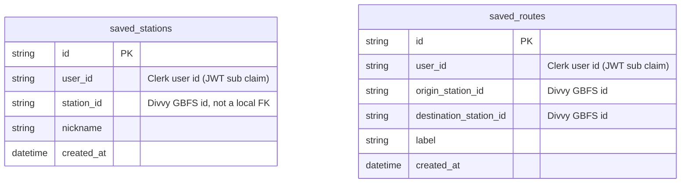

## This is NOT the Next.js you know

This version has breaking changes — APIs, conventions, and file structure may all differ from your training data. Read the relevant guide in `node_modules/next/dist/docs/` (resolved from this file's directory; in monorepos the `next` package may not be visible from the repo root) before writing any code. Heed deprecation notices.

This block is written and re-added by `next dev` — verify at `node_modules/next/dist/server/lib/generate-agent-files.js`. Removing it from a diff only re-creates the uncommitted change; committing it with your work keeps the tree clean.

---

# Divvy Bike Explorer — Project Notes

Read this file before building anything. If a feature needs a new table or
column, update this doc first, then build.

## What the app does

Lets someone search/browse live Chicago Divvy station data, see the station
closest to them as soon as they open the app, plan a route between two
stations, and save things so they can come back to them later without
re-entering everything from scratch.

## What the Divvy API actually gives you

Divvy publishes its live system data as a **GBFS** feed (General Bikeshare
Feed Specification — the standard most bike/scooter share systems use). The
feeds that matter here:

- **`station_information.json`** — the static list of stations: `station_id`,
  name, lat/lon, total dock capacity. Changes rarely (new stations added/removed).
- **`station_status.json`** — the live part: for each `station_id`, how many
  classic bikes are available, how many e-bikes, how many empty docks, and
  whether the station is currently renting/accepting returns, plus a
  `last_reported` timestamp.
- **`free_bike_status.json`** — dockless e-bikes currently sitting outside a
  station (lat/lon of each bike), if Divvy has any in your area.
- **`system_pricing_plans.json`** — the price plans, useful for estimating
  what a planned trip would cost.
- **`system_alerts.json`** — service alerts (closures, outages).

Important gap: **Divvy's API has no route/directions endpoint.** It only gives
you points (stations), not paths. A real "plan a route" feature means picking
a start + end station from Divvy's data, then handing those two coordinates
to a separate routing service (e.g. OSRM, GraphHopper, Mapbox/Google
Directions) to get an actual cycling path. Worth deciding which routing
service to use before building that feature.

Also note: Divvy's *historical* trip data (the big CSV dumps of past rides)
is a separate, static download — not part of the live API, and not something
this app needs for the two core features.

## Feature ideas beyond the two you named

- **Favorite/pinned stations** — "Home," "Office," etc. for one-tap status checks.
- **Saved routes** — store an origin/destination pair (e.g. a daily commute)
  so the user doesn't re-pick stations every time.
- **Recent searches** — last few stations or addresses looked up, for quick
  re-access without saving them permanently.
- **"Will there be a bike/dock when I arrive?"** — a simple trend check using
  recent status history. This would need a small cache of past station
  status, but that's *system* data, not personal data — no `user_id` needed.
- **Availability alerts** — notify when a favorited station frees up a dock
  or gets a bike (needs a background job; good v2 feature, skip for v1).
- **E-bike vs. classic bike breakdown** at a glance, since it affects pricing
  and whether a dock will even accept the bike back.
- **System alerts surfaced** on the home screen (closures, high-demand).
- **Trip cost estimate** for a planned route using `system_pricing_plans`.

## What gets saved, and to whom it belongs

- Station data and live status (names, locations, bike/dock counts) is
  **Divvy's public data**. We fetch it and may cache it for performance, but
  nobody *owns* it — it's not tied to a `user_id` and isn't personal data.
- The only things that are personal are the choices a specific person makes:
  which stations they favorited, which routes they saved. Those rows belong
  to that person and must carry a `user_id`.
- Scope discipline: the two requested features (nearest station, route
  planning) don't require logging where someone has actually ridden or
  storing GPS trails — just what they've chosen to save for later. Don't add
  a trip-history table unless a feature explicitly needs it.

## Data model (2 tables)

Auth is handled by **Clerk** (set up via `clerk init`). Clerk already owns
identity (email, account creation time, etc.), so there's no local `users`
table — `saved_stations` / `saved_routes` store Clerk's `user_id` (the JWT
`sub` claim) directly as a plain string. Supabase trusts Clerk's session
tokens via a Third-Party Auth integration (not the deprecated JWT-template
approach), so RLS policies read the user id straight off `auth.jwt()`.

- **`saved_stations`** — a person's favorited stations. Every row belongs to
  exactly one Clerk user via `user_id`.
- **`saved_routes`** — a person's saved origin → destination pairs. Every row
  belongs to exactly one Clerk user via `user_id`.

`station_id` / `origin_station_id` / `destination_station_id` are plain
strings copied from Divvy's live feed — not foreign keys into a local table,
because we don't persist Divvy's station data ourselves. If a station gets
renamed or removed upstream, we just show stale info rather than owning a
sync problem.

RLS on both tables: `(select auth.jwt()->>'sub') = user_id` for all
operations, scoped `to authenticated`. This requires the Clerk↔Supabase
Third-Party Auth wiring (Clerk's "Connect with Supabase" page +
Supabase's Authentication → Third-Party Auth → Clerk) to be set up first,
otherwise `auth.jwt()` won't carry a trusted Clerk session.
